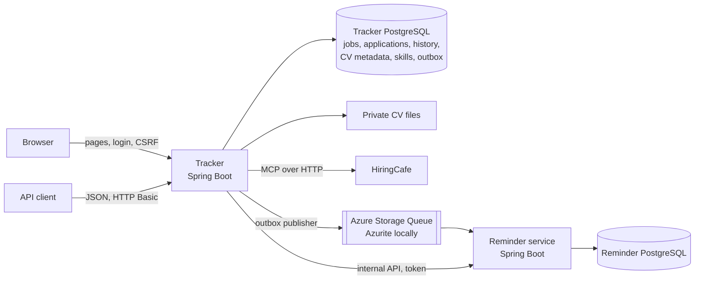

# JobTrack


A personal job application tracker, built step by step to learn Java 25, Spring
Boot 4, PostgreSQL, Docker, event-driven microservices and Azure. Everything in
this repository uses fictional data.

## What it does

- **Track applications** through clear stages (Saved → Applied → Interview → Offer
  → Accepted, or Rejected / Withdrawn), with a dated history and notes. Stages only
  move forward, and the rules are enforced in the domain model and the database.
- **Search HiringCafe** live and track the jobs you choose, without duplicates.
- **Compare jobs with your CV**: skills are read from your PDF or Word CV on your
  own machine, and each search result shows which of its required skills you have
  and which are missing. Rule-based and explainable; no AI service is involved.
- **Keep CV versions** privately and record which one you sent.
- **Set follow-up reminders**, handled by a separate reminder service.
- **Export** all of your records as JSON.

## Architecture



- **Tracker** ([app/](app/README.md)): a modular Spring Boot application with
  tracking, job source, documents, matching, reminders and export modules, server-
  rendered pages and a JSON API.
- **Reminder service** ([reminder-service/](reminder-service/README.md)): owns
  reminders and their database. The tracker sends changes through a transactional
  outbox and a queue, and the service handles duplicates and out-of-order messages
  with event IDs and versions ([docs/events.md](docs/events.md)).

## Run it

You need Docker and JDK 25. From `app/`:

```bash
docker compose up -d --build
./mvnw spring-boot:test-run
```

The second command starts the tracker with fictional demo data at
<http://localhost:8080> (sign in as `demo` / `demo-password`). For personal use,
see [app/README.md](app/README.md#run-it).

## Tests and CI

About 150 automated tests across both services, run on every push by
[GitHub Actions](.github/workflows/ci.yml): domain rules, the HiringCafe adapter
against a local fake server, CV reading and skill matching, the outbox under queue
failures, the reminder service's duplicate and ordering rules, page behaviour, and
integration tests against real PostgreSQL 18 and Azurite started by Testcontainers.
CI also builds both Docker images and checks that they contain only the app.

## Design notes

The [case study](docs/case-study.md) explains the main decisions and their
trade-offs, the problems found during the build and how they were fixed, and what
could be improved. Other documents:

| Document | About |
| --- | --- |
| [docs/project-plan.md](docs/project-plan.md) | Learning plan, scope, milestones |
| [docs/data-integration.md](docs/data-integration.md) | Data ownership and the HiringCafe integration |
| [docs/events.md](docs/events.md) | Reminder events, guarantees and failure handling |
| [docs/azure-lab.md](docs/azure-lab.md) | Temporary Azure deployment: cost checks, steps, cleanup |
| [docs/milestone-0-notes.md](docs/milestone-0-notes.md) | Toolchain and provider checks, with dates |
| [docs/design-prompt.md](docs/design-prompt.md) | The UI brief given to Claude Design |
| [lessons/](lessons/) | The first two plain-Java lessons |

## Privacy

Real CVs, application records, database exports and credentials stay out of Git
and out of container images. CV text is read in memory and never stored; only skill
names are kept. Live job search is off in the public demo, and no real job listings
are published, in line with HiringCafe's terms.

## Status

| Milestone | Status |
| --- | --- |
| 0. Toolchain and provider checks | Done |
| 1–5. Tracker, API, PostgreSQL, dashboard and login, HiringCafe | Done |
| 6. CVs, reminders, export | Done |
| 7. Docker and CI | Done |
| 8. Temporary Azure deployment | Infrastructure files ready ([docs/azure-lab.md](docs/azure-lab.md)); deployment needs an Azure account |
| 9. Reminder service | Done |
| 10. Portfolio release | Write-up done; screenshots and a walkthrough video still to record |
| Extra: CV skill matching | Done (added on request on November 2, 2026) |
