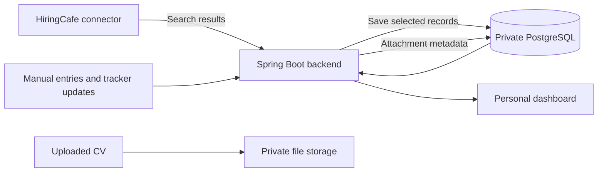

# Data integration blueprint

Planning reference checked on October 31, 2026. This is a proposed design, not an
implemented integration or a successful live endpoint test.

The [project and learning plan](project-plan.md) defines the implementation stages
and their completion criteria. A small feasibility check precedes the full adapter.

## Where the data comes from

| Data | Source | Planned storage |
| --- | --- | --- |
| Selected job title, company, location, source ID, and link | Manual entry or a selected HiringCafe result | Private PostgreSQL database |
| Application stage and dates | Entered by the user | Private PostgreSQL database |
| Interview notes, follow-up dates, and reminders | Entered by the user | Private PostgreSQL database |
| CV version and attachment metadata | Entered or uploaded by the user | Private PostgreSQL database |
| CV file contents | Uploaded by the user | Private local files initially; private Azure Blob Storage in a later cloud lesson |
| Portfolio examples | Fictional records created for the project | Public demo fixtures, kept separate from personal records |

The database is the source of truth for personal application progress. A job
listing provider supplies discovery information, not confirmation that an
application was submitted or an interview was offered.

## Example data flow

Search results are initially temporary. Only a deliberate save action creates or
links a tracker record. Stored attachments are accessed through an authorization
check; a database row contains a storage key, not a publicly accessible CV URL.

## Relationships

- `TrackedJob`: a user's selected role, company name, location, source, external
  job ID when available, source URL, and import time.
- `Application`: links a user to a tracked job and the CV version used, with
  current stage and application date.
- `ApplicationEvent`: records a stage change or note and its timestamp.
- `Reminder`: links to an application and records a due date and completion state.
- `CvVersion`: records a user-owned file's storage key, display name, version
  label, and upload time.

One job can have an application; one application can have many events and
reminders. A CV version can be used for multiple applications. Even for a personal
project, records belong to a user so that authentication and ownership checks can
be learned without exposing personal data.

## HiringCafe integration

HiringCafe's official connector documentation states that any MCP-compatible
client can connect to `https://hiringcafe.com/api/mcp` using Streamable HTTP,
without authentication. It exposes `search_jobs` and `get_job_details`.

MCP is a protocol for calling external tools. Our backend can use a Java MCP
client to call these operations directly; an AI model is not required for the
proposed search-and-save workflow.

Proposed user interaction:

1. Enter search filters, such as Java, Latvia, entry level, and remote preference.
2. The backend calls HiringCafe and maps available response fields into our own
   search result objects. Missing fields remain missing rather than being invented.
3. Review results and follow their source links for the current listing.
4. Choose a result to track. The backend validates the selection and saves the
   necessary private metadata and source link.
5. Record application stages and reminders inside JobTrack.

The connector is read-only. It does not expose a user's HiringCafe saved jobs,
CV, application history, or profile, and it cannot submit applications or update
that account. Those features must not be presented as synchronized with JobTrack.

The provider documentation establishes the connection mechanism. A first live
check on November 1, 2026 confirmed both tools without authentication and
recorded their actual response shapes; see
[Milestone 0 notes](milestone-0-notes.md#hiringcafe-mcp-feasibility-check). The
adapter is now implemented in `app/` and tested against fictional responses; see
[the app README](../app/README.md#hiringcafe-integration). A live search and
de-duplicated import through the app succeeded on November 2, and the current
documentation and terms were reviewed the same day; see
[the notes](milestone-0-notes.md#documentation-and-terms-recheck). Availability and
limits can change.

## Reliability rules to implement

- Identify an imported job by provider and external job ID within the user's
  records. Use a normalized source URL for manually entered jobs without an ID.
  Keep query parameters unless their non-identifying purpose is known.
- Make repeated imports return the existing record rather than create duplicates.
- Keep user-written notes and application history unchanged when provider data changes.
- Treat a failed lookup as an unknown provider state, not proof that a job closed.
- Use bounded requests and retries, and respect `Retry-After` on rate-limit responses.
- Call the provider on user request. Avoid continuous polling or bulk harvesting.
- Keep manual entry available when the provider is unavailable.
- Use a replaceable `JobSource` interface so provider-specific responses stay
  outside the tracker domain model.

## Public portfolio behavior

HiringCafe's terms restrict republishing and redistributing its material. The
public repository will contain connector code and fictional test responses, not
an exported job catalog or real personal tracker records. Public screenshots and
recordings will use fictional records. Broader redistribution or persistent
storage of provider content needs a separate review of the applicable permissions.

The public demo profile will use fictional data and disable live provider calls.
Personal use and integration checks will use explicit configuration. No claim of
an official HiringCafe partnership will be made.

## Implementation order

Implement manual entry, the application workflow, and persistence first. Add the
provider adapter next. Test imports, repeated saves, provider failures, and record
ownership using fictional fixtures. Perform a separate, explicit live check of
the documented connector before describing the integration as working.

## Primary references

- [HiringCafe connector documentation](https://hiringcafe.com/documentation/hiringcafe-claude-connector)
- [HiringCafe terms](https://hiringcafe.com/terms-and-conditions)
- [Official MCP Java client documentation](https://java.sdk.modelcontextprotocol.io/latest/client/)
