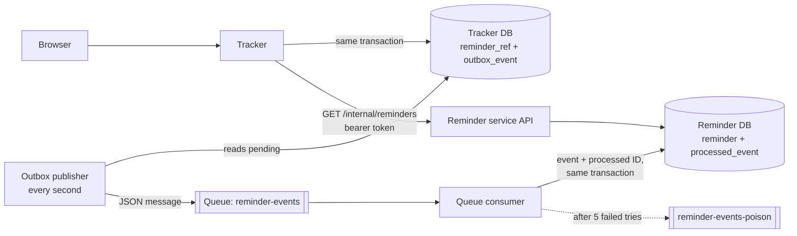

# Reminder events

The tracker (`app/`) and the reminder service (`reminder-service/`) share no
database. The tracker sends reminder changes as JSON messages on an Azure Storage
Queue (Azurite locally); the reminder service applies them and answers the
tracker's read requests on an internal API.



## Message format

```json
{
  "eventId": "5f0b7e64-1f1d-4c8e-9a6e-2d9d3b7f0a11",
  "type": "REMINDER_SCHEDULED",
  "occurredAt": "2026-11-02T10:00:00Z",
  "ownerId": 1,
  "applicationId": 7,
  "reminderId": "9b1f3c2e-4d5a-4e6f-8a7b-0c1d2e3f4a5b",
  "version": 1,
  "dueAt": "2026-11-09T08:00:00Z",
  "note": "Email the recruiter"
}
```

| Type | Sent when | Carries |
| --- | --- | --- |
| `REMINDER_SCHEDULED` | A reminder is added (always version 1) | `dueAt`, `note` |
| `REMINDER_RESCHEDULED` | Its due time changes | `dueAt` |
| `REMINDER_COMPLETED` | It is marked done | — |
| `REMINDER_CANCELLED` | Its application is archived | — |

Every event about one reminder has a higher `version` than the one before. Events
carry IDs, times and the reminder's own short note, never CV contents or interview
notes. Unknown fields are ignored, so either side can add a field first.

## Guarantees and how they are met

| Problem | What happens |
| --- | --- |
| The change is saved but the message is lost | Cannot happen: the event is written to `outbox_event` in the same transaction as the change, and the publisher keeps it until the queue accepts it. |
| The queue is down | The publisher records the error and retries after 2, 4, 8 … seconds (at most 5 minutes). Pages show "on its way". |
| The same message arrives twice | The reminder service stores each handled `eventId` in `processed_event`, in the same transaction as the effect, and ignores repeats. |
| Messages arrive out of order | A message whose `version` is not newer than the stored one changes nothing. The tracker also never sends a reminder's later event while an earlier one is waiting for a retry. |
| "Completed" arrives before "scheduled" | A finished placeholder is stored, so the late "scheduled" cannot bring the reminder back; it only fills in the note. |
| A message can never be applied | After 5 deliveries (or at once, if it is not valid JSON) it moves to `reminder-events-poison` for inspection. |
| The reminder service is down | Messages wait in the queue. Pages show "Reminders can't be loaded right now" and everything else works; the API answers 503. |

All of these are covered by tests in both services, and the outage cases were
checked by stopping containers on November 2, 2026.

## Delivery is at least once

If the tracker stops after the queue accepted a message but before it saved
"published", it sends the message again after restart. The reminder service's
duplicate check makes that harmless, which is why both halves are needed.

## Cloud scheduling

Locally both services run all the time. In the planned Azure lab the reminder
service can scale to zero; its queue consumer then needs a trigger (a scheduled
Container Apps job or a queue-length scale rule) to run, because a stopped
container cannot run its own timer.
