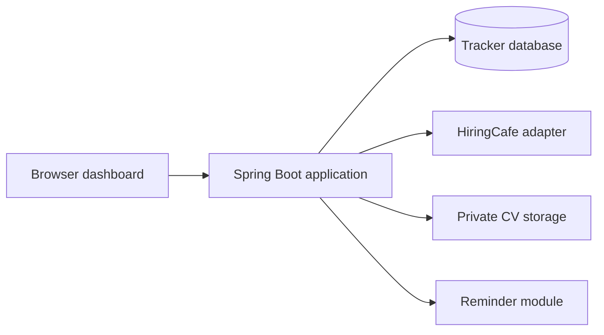

# JobTrack project and learning plan

Planned on October 31, 2026. Planning only: application code, a live HiringCafe
connection, and Azure resources have not been created or verified.

## Outcome

Build a personal job search organizer that can be explained and demonstrated in
a developer portfolio. Learn Java, Spring Boot, persistence, security, integration,
containers, Azure, and microservices by delivering one working feature at a time.

The project is for personal use and demonstrations. It does not need public
registration, a permanent live website, or infrastructure running all month.

## Learning baseline and pace

The learner has worked with object-oriented TypeScript and understands basic
Java concepts. Available time is **4-6 hours per week**. Begin with a short Java
translation exercise to check understanding, then move quickly into features.

Use familiar TypeScript concepts as reference points:

| Familiar concept | Java focus |
| --- | --- |
| Classes, constructors, encapsulation | Field visibility, constructor rules, packages, and Java conventions |
| TypeScript interfaces | Explicit `implements` relationships and contracts between application components |
| Arrays, maps, and generic types | `List<T>`, `Map<K, V>`, collection APIs, and Java generic types |
| Optional values | Null handling and appropriate uses of `Optional` in return types |
| Errors and exceptions | Exception types, checked exceptions, and useful validation errors |
| npm scripts and packages | Maven, dependency management, compilation, tests, and JAR files |

Introduce Spring's dependency injection by first wiring ordinary Java objects
explicitly. Add framework support once the purpose of those dependencies is clear.

## Scope and checkpoints

**First usable version:** add jobs manually, track application stages, search and
filter saved jobs, record notes, and use a simple authenticated dashboard. Data
survives application restarts.

**Integrated version:** search HiringCafe, save a selected job without duplicates,
attach a CV version, and manage follow-up reminders. The tracker still works when
the external provider is unavailable.

**Portfolio version:** reproducible local setup, meaningful tests, a CI pipeline,
temporary Azure deployment evidence, a reminder microservice, documentation,
fictional demo data, and a short walkthrough recording.

Automatic job applications, mailbox access, bulk job aggregation, AI matching,
paid email/SMS delivery, and subscriptions are outside the planned version.

## Proposed stack

| Area | Choice | Purpose |
| --- | --- | --- |
| Language | Java 25 LTS, using an OpenJDK distribution | Learn Java fundamentals and use a supported baseline |
| Backend | Stable Spring Boot 4.x, Maven Wrapper | Build an HTTP application and manage dependencies reproducibly |
| UI | Thymeleaf, HTML, CSS, small amounts of JavaScript | Deliver a usable interface while keeping Java central |
| Database | PostgreSQL, Spring Data JPA, Flyway | Learn SQL, relationships, transactions, and schema migrations |
| Authentication | Spring Security sessions | Login, password hashing, CSRF protection, and record ownership |
| Job discovery | HiringCafe MCP adapter | On-demand external job search and selected imports |
| Tests | JUnit, Spring test support, PostgreSQL Testcontainers | Verify business rules and behavior against the actual database engine |
| Local environment | Docker Compose; Azurite when storage is introduced | Reproduce dependencies locally |
| Cloud | Azure Container Apps, Blob Storage; Storage Queue in the distributed stage | Practice deployment, private attachments, and asynchronous communication |
| Infrastructure | Azure CLI and Bicep | Describe, deploy, inspect, and remove a repeatable cloud environment |
| Automation | GitHub Actions | Build and test commits; later support deliberately triggered deployment |

Pin exact releases when implementation begins and check dependency compatibility
at that point. Spring's current requirements support this Java baseline. Azurite
supports local Blob and Queue storage development; a cloud check is still needed
because the emulator is not identical to Azure.

## Architecture progression

Initially, one Spring Boot application owns modules for tracking, job sources,
documents, and reminders, with one private PostgreSQL database. Keeping these
boundaries clear makes the later service extraction understandable.

Later, reminders become a separately deployable Spring Boot service. Tracker
changes produce events through a queue. The reminder service owns its own
database, and authenticated internal requests let the dashboard read reminders.
Local services may use different databases on the same PostgreSQL server, with
separate credentials and no cross-service table access.

Cloud scheduling must be explicit: a service scaled to zero cannot run a local
timer. A scheduled Container Apps Job will wake the reminder worker for cloud
demonstrations. No continuous cloud worker is required between learning sessions.

## Milestones

These estimates include explanations, exercises, and debugging, using the
reported TypeScript OOP experience and basic Java knowledge as the starting point.
They are planning ranges, not deadlines. Revisit them after the first two lessons.

| Stage | Deliverable | Main learning | Completion criterion | Estimate |
| --- | --- | --- | --- | --- |
| 0. Setup and feasibility | Verified JDK, editor, Git, Maven Wrapper, Docker; a small HiringCafe connection check | Toolchain, command line, Git, external dependency verification | A small Java program runs; PostgreSQL can start; provider findings and actual schemas are recorded | 2-4 h |
| 1. Java domain | In-memory jobs and application tracking | Java differences from TypeScript, enums, collections, interfaces, exceptions, dates | Add and list jobs; apply stage rules; explain the model and test meaningful rules | 4-8 h |
| 2. Spring API | Create, read, update, and archive tracker records over HTTP | HTTP, JSON, controllers, services, dependency injection, validation | Requests work; invalid input gets consistent errors; missing records are handled | 8-12 h |
| 3. Persistence | PostgreSQL-backed records and change history | SQL first, JPA mapping, migrations, transactions | Data survives restart; history and current stage update atomically; database constraints prevent duplicate imports | 8-12 h |
| 4. Dashboard and security | Login, saved-job list, filters, application detail, notes | Thymeleaf forms, sessions, CSRF, password hashing, authorization | The complete manual tracking workflow works in a browser; a second test user cannot read another user's records | 10-16 h |
| 5. HiringCafe | Search, preview, and save selected jobs through an adapter | MCP client calls, external response mapping, timeouts, limits, idempotency | A small live search succeeds; repeated saves do not duplicate jobs; simulated provider failures preserve manual tracking | 6-10 h |
| 6. CVs and reminders | Private CV versions, due dates, in-app reminders, personal record export | File storage, access checks, scheduling, time zones, data export | A CV can be uploaded and downloaded only by its owner; reminders can be scheduled, changed, and completed | 8-12 h |
| 7. Containers and CI | Reproducible local application and automated checks | Docker images, Compose, environment configuration, GitHub Actions | A clean checkout builds and runs from documented steps; CI executes meaningful tests; no private files are included in the image | 6-10 h |
| 8. Azure lab | Temporary deployment, private storage exercise, repeatable infrastructure and cleanup | Resource groups, identity, permissions, configuration, logs, Bicep, cost inspection | Recreate the demo, exercise it over HTTPS, capture evidence, remove its temporary cloud resources, and inspect cost reporting | 8-14 h |
| 9. Microservices | Separate reminder service with its own data and queue-based events | Service boundaries, transactional outbox, retries, duplicate handling, eventual consistency | A failed delivery is retried; duplicate and stale events do not duplicate or resurrect reminders; restart recovery is demonstrated | 12-20 h |
| 10. Portfolio release | Documented public repository, case study, diagrams, screenshots, video | Technical communication and explaining tradeoffs | Another developer can run the fictional demo; the learner can explain the architecture and demonstrate one feature without a script | 4-8 h |

Estimated total: approximately **75-130 focused hours**, with a useful manual
tracker around stages 0-4, approximately **30-55 hours**. At 4-6 hours per week,
allow roughly **6-14 weeks for the first usable tracker** and **3-8 months for
the full learning path**. The first usable version is a real checkpoint; later
milestones can be released incrementally.

## Domain rules and data integration

The main entities are user, tracked job, application, application event, CV
version, and reminder. Application is a tracking card; the SAVED stage does not
claim an application has been submitted.

Initial stages: SAVED, APPLIED, INTERVIEW, OFFER, ACCEPTED, REJECTED, WITHDRAWN.
Changes and corrections are recorded in history. Dates are stored consistently
and reminder times are displayed in the user's chosen time zone.

Use provider identity and job ID for imports, with source URL as the fallback for
manual entries. The database enforces duplicate rules within each user's records.
Provider updates never overwrite the user's notes, CV choices, or stage history.

HiringCafe supplies discovery data. It does not supply the user's saved jobs,
application outcomes, or CVs. The documented connector must be exercised in stage
0 to reduce dependency risk before the full adapter is implemented in stage 5.

See [the integration blueprint](data-integration.md) for details and references.

Example API shape, to refine when the relevant lesson starts:

| Action | Proposed endpoint |
| --- | --- |
| Add or list saved jobs | `POST /api/jobs`, `GET /api/jobs` |
| Create a tracking card | `POST /api/applications` |
| Record a stage change | `PATCH /api/applications/{id}/stage` |
| Add a note | `POST /api/applications/{id}/notes` |
| Search the external source | `GET /api/sources/hiringcafe/jobs` |
| Import a selected source job | `POST /api/imports/hiringcafe` |
| Upload a CV version | `POST /api/cv-versions` |
| Schedule a follow-up | `POST /api/applications/{id}/reminders` |

## Microservice delivery rules

In stage 9, save tracker changes and outgoing events in the same database
transaction. An outbox publisher delivers pending events to Azure Storage Queue,
or Azurite locally. Acknowledge a message after its effects are committed in the
reminder service's database. Store handled event IDs to make retries safe.

Events carry identifiers, due times, and a version, rather than CV contents or
interview notes. Version checks handle changes and cancellations that arrive out
of order. Each service enforces its own access boundaries. The dashboard can
display that an update is pending while the reminder service catches up.

For local exercises, workers and timers run while the containers are running.
The cloud version uses an explicitly scheduled worker job. Document this behavior
instead of suggesting reminders execute when every component is switched off.

## Cost and privacy approach

Target hosting spend: **EUR 0**. Most work runs locally, including Blob and Queue
exercises with Azurite. Do not start a new Azure trial during early Java lessons;
use its limited duration for actual cloud exercises.

The first Azure demo uses fictional records. A free external PostgreSQL database,
such as Neon's Free plan, is the proposed cloud database to avoid assuming Azure
managed PostgreSQL is permanently free. An Azure PostgreSQL exercise is optional
and depends on verified trial coverage and the remaining budget.

Container Apps, storage operations, logs, image storage, networking, and databases
must all be included in the deployment estimate. Free compute allowance alone
does not establish a zero-cost deployment. Cost alerts inform; they do not cap
spending. Account eligibility, credits, and current limits are checked at the
cloud milestone. Staying within credit can avoid out-of-pocket spend while still
consuming resources that otherwise have a price.

Use one dedicated resource group for disposable lab resources. Keep backups and
personal data separate. After a lab, confirm cleanup succeeded and inspect any
remaining resources, including outside the group. Usage reporting can lag.
No resource creation or paid subscription upgrade is part of the planning stage.

Public GitHub and portfolio content use fictional fixtures. Actual CVs, personal
exports, secrets, and external job catalogs are excluded. Live job discovery is
disabled in the public demo profile. GitHub deployment authentication should use
short-lived identity credentials where supported, with no credentials committed
to source control.

## How lessons will work

Suggested weekly rhythm, with no fixed calendar appointments:

- 90 minutes: a focused explanation and guided implementation.
- 90 minutes: finish the feature and inspect its behavior.
- 60 minutes: an independent exercise, review, and a working commit.
- Optional 1-2 hours: debugging, extra practice, or improving documentation.

Each lesson has one small objective and follows this sequence:

1. Explain the feature and the concept it introduces.
2. Build a small piece together, explaining unfamiliar syntax and decisions.
3. Run it and inspect a request, database record, log, or visible result.
4. Complete a short independent change and explain what happened.
5. Review the result, add an appropriate check, and commit a working checkpoint.

Tests begin with business rules and grow with the features. Important scenarios
include invalid transitions, atomic history updates, duplicate imports, provider
timeouts and rate limits, record ownership, private attachment access, and event
redelivery. Real external services are checked separately from deterministic CI.

For each milestone, record a short note: what was built, why it was designed that
way, how it was checked, and what could be improved. These notes become material
for the portfolio case study and interview preparation.

## First lesson

Verify the Java toolchain, then translate a familiar TypeScript-style `Job` class
into Java with a title, company, and source link. Create two fictional jobs, keep
them in a `List<Job>`, and print them from `main`. Explain the Java-specific syntax,
visibility, compilation, and collection choices. The first independent exercise
is to add a location and reject a blank job title.

Use the first 1-3 weeks for setup and the compact Java domain model, depending on
toolchain issues and exercise results. Move into the first Spring endpoint as
soon as these foundations are comfortable.

This lesson starts only after planning; no application implementation is included
in this planning change.

## References checked during planning

- [Spring Boot requirements](https://docs.spring.io/spring-boot/system-requirements.html)
- [Java LTS roadmap](https://www.oracle.com/java/technologies/java-se-support-roadmap.html)
- [HiringCafe connector](https://hiringcafe.com/documentation/hiringcafe-claude-connector)
- [Azurite local storage emulator](https://learn.microsoft.com/en-us/azure/storage/common/storage-use-azurite)
- [Azure Container Apps](https://learn.microsoft.com/en-us/azure/container-apps/overview)
- [Bicep infrastructure definitions](https://learn.microsoft.com/en-us/azure/azure-resource-manager/bicep/overview)
- [Azure Container Apps billing](https://learn.microsoft.com/en-us/azure/container-apps/billing)
- [Azure trial charges and limits](https://learn.microsoft.com/en-us/azure/cost-management-billing/manage/avoid-charges-free-account)
- [Budget alerts do not stop consumption](https://learn.microsoft.com/en-us/azure/cost-management-billing/costs/tutorial-acm-create-budgets)
- [Neon Free plan](https://neon.com/pricing)
